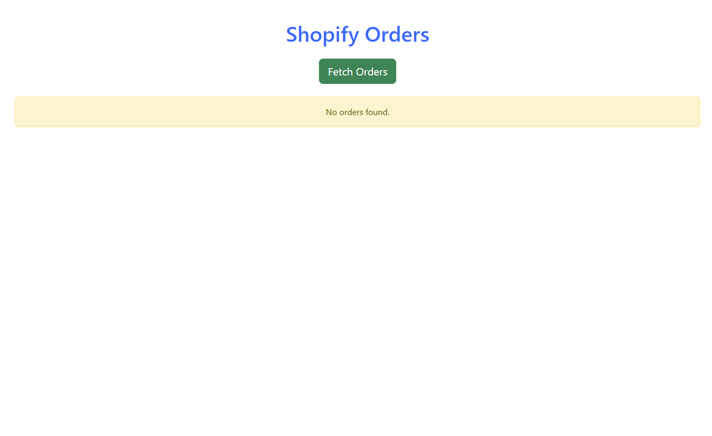
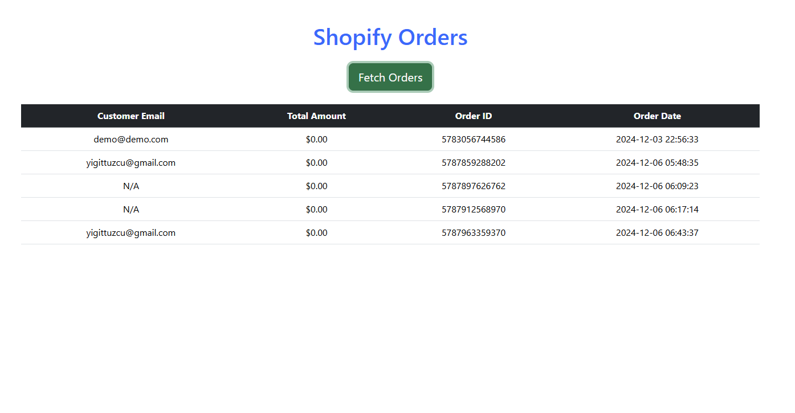
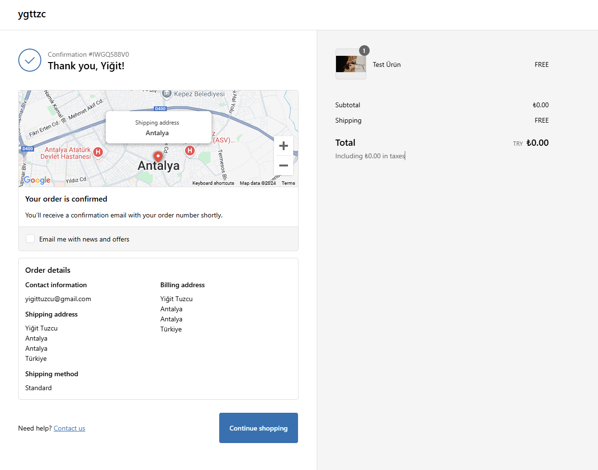

# Shopify Orders App


A Laravel 11 + Vue 3 application that syncs orders from a Shopify store into MySQL through the Shopify Admin API and displays them in a clean, responsive dashboard.



## Features

- **One-click sync** — a "Fetch Orders" button pulls the last year of orders from the Shopify Admin API.
- **Idempotent persistence** — orders are stored with `updateOrCreate` keyed on the Shopify order ID, so re-fetching never creates duplicates.
- **Clean separation** — all Shopify API logic lives in a dedicated `ShopifyService`; the controller stays thin.
- **Vue 3 frontend** — the orders table is a Vue single-file component served by Vite, talking to a JSON endpoint.

## How it works

```
[Fetch Orders button]
        │  GET /fetch-orders
        ▼
ShopifyController ──► ShopifyService ──► Shopify Admin API (orders.json, last 365 days)
        │                                        │
        ▼                                        ▼
   updateOrCreate(shopify_order_id) ◄── customer email · total · order date
        │
        ▼
     MySQL ──► GET /orders-list (JSON) ──► OrdersApp.vue table at /orders
```

## Getting started

Requirements: PHP ≥ 8.2, Composer, MySQL, Node.js + npm, and a Shopify store with a private app (Admin API access).

```bash
git clone https://github.com/tuzcuy/shopify-orders-app.git
cd shopify-orders-app
composer install
npm install
cp .env.example .env
php artisan key:generate
```

Set your database and Shopify credentials in `.env`:

```env
DB_DATABASE=shopify_orders_app
DB_USERNAME=your-db-user
DB_PASSWORD=your-db-password

SHOPIFY_API_KEY=your-api-key
SHOPIFY_ACCESS_TOKEN=your-admin-api-access-token
SHOPIFY_STORE=your-store.myshopify.com
```

Then create the database, migrate, and run:

```bash
php artisan migrate
php artisan serve      # backend on http://localhost:8000
npm run dev            # Vite dev server for the Vue frontend
```

Open [http://localhost:8000/orders](http://localhost:8000/orders) and click **Fetch Orders**.

## Screenshots

| Orders list | After fetching | Creating a test order |
|---|---|---|
|  |  |  |

## Project structure

```
app/
├── Http/Controllers/ShopifyController.php   # fetch & list endpoints
├── Models/Order.php
└── Services/ShopifyService.php              # all Shopify Admin API logic
database/migrations/                          # orders table schema
resources/js/components/OrdersApp.vue         # orders table (Vue 3)
routes/web.php
```

## What I'd improve next

- Replace the manual fetch with **Shopify webhooks** (`orders/create`, `orders/updated`) for real-time sync.
- Move the sync into a **queued job** with cursor-based pagination and Admin API rate-limit handling.
- Add **feature tests** for the fetch/list endpoints with a mocked Shopify client (Pest is already wired).
- Server-side pagination and filtering for large order volumes.

## License

[MIT](LICENSE)
